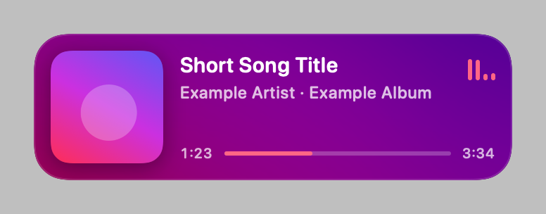

# Now Playing

A small floating card for your Mac that shows what's playing in Spotify or Apple Music.

If you're anything like me, you play random public playlists to discover music. I use Spotify as my discovery ground: I search for moods, feelings and types of music and see what comes up. Sometimes a song comes on that I really like, or I just have no idea what I'm listening to, and I want to glance at it without stopping what I'm doing and digging through Spotify. So I made this little card that sits on my screen and tells me what's playing.



The card stays on top of your other windows and appears on every desktop. Its background is a blurred copy of the album cover, and the progress bar and equalizer take their colour from the cover.

## Install

You need macOS 14 or later and Apple's command line tools. If you don't have the tools yet, install them with:

```bash
xcode-select --install
```

Then download the code, build the app and open it:

```bash
git clone https://github.com/sofiatraba/now-playing-mac.git
```

```bash
cd now-playing-mac
```

```bash
./build.sh
```

```bash
open ~/Applications/Now\ Playing.app
```

The card appears in the top-right corner of your screen. The first time it runs, macOS asks whether Now Playing may control Spotify or Music. Click OK, otherwise the card can't read what's playing.

After that, you can open it from Spotlight by typing "Now Playing".

## How to use it

Hover over the card to show the previous, play/pause and next buttons. Click or drag the progress bar to jump within a song, and click the album cover to open the music app.

Drag the card to move it. It snaps to a screen edge if you let go close to one, and it remembers where you left it.

Click the X in the top-left corner to quit. The X only shows while you're hovering. Right-click the card to turn Always on Top on or off.

## Privacy

The app has no accounts, API keys, analytics or settings to fill in. It asks Spotify or Music on your Mac what's playing, using AppleScript. The only thing it fetches from the internet is the album cover for the current Spotify song, from Spotify's image server.

## Troubleshooting

**The card says "Allow access to Spotify" or "Allow access to Music".** Click the card to open the Automation settings, then turn on the music app under Now Playing.

**macOS asks for permission again after a rebuild.** This is expected. The app is signed locally, so macOS treats each new build as a different app.

**macOS 27 is the only version it has been tested on.** It's built to run on macOS 14 and later, so please open an issue if something breaks on an older version.

## Uninstall

Quit the app, then delete it and its saved settings:

```bash
rm -rf ~/Applications/Now\ Playing.app
```

```bash
defaults delete local.nowplaying.card
```

## License

MIT. See [LICENSE](LICENSE).
